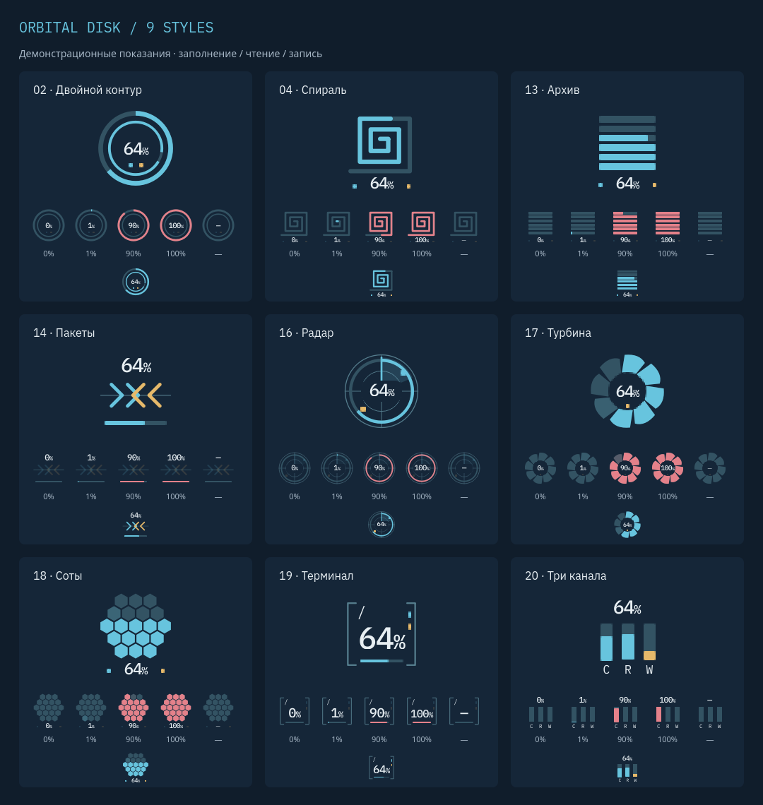

# Orbital KDE rice

A restrained mission-control look for KDE Plasma 6: dark navy surfaces, muted cyan and amber accents, original orbital wallpaper, a full-width bottom panel, IBM Plex typography, and Tela Circle Blue icons.


## Components

| Component | What it provides |
| --- | --- |
| [Orbital CPU](widgets/org.orbital.cpu/) | Animated Classic, Constellation and Pulsar orbits, CPU usage, and temperature/frequency tooltips. |
| [Orbital Memory](widgets/org.orbital.memory/) | Fan and Silicon RAM indicators with an optional Fan swap gauge. |
| [Orbital Disk](widgets/org.orbital.disk/) | Nine space and read/write indicators, a selectable partition, and Terminal as the default style. |
| [Orbital Battery](widgets/org.orbital.battery/) | A 20-cell charge grid with brightness, power profiles, and sleep inhibition controls. |
| [Appearance assets](assets/) | Dark/light palettes, KDE/Konsole colors, wallpapers in two resolutions, a Konsole profile, and an Oh My Zsh prompt. |
| [Installation scripts](scripts/) | Desktop setup, separate widget upgrades, snapshots, restore, and an optional SDDM override. |

The default desktop installs and adds **Orbital CPU**, **Orbital Memory**, and **Orbital Disk**.
**Orbital Battery** is optional. The widgets are independent Plasma applet packages
and can be installed without applying the desktop theme.

## Lunar application launcher

The existing Kickoff launcher can use an Orbital Moon icon whose illuminated
shape follows the real Moon. Calculations run locally with bundled Astronomy
Engine 2.1.19; no network access, location lookup, pip installation, or PyQt runtime
is needed. The north-up design lights the right side while waxing and the left
while waning. The disc, accent arc, and faint new-Moon outline follow the active
KDE palette, including generated Orbital schemes.

Install and activate for the current user in a running Plasma session:

```bash
./scripts/orbital-moon install
~/.local/bin/orbital-moon status
```

Installation selects the single Kickoff on the bottom panel and preserves its
menu, favorites, shortcut, and original icon. The icon updates immediately,
15 seconds after login, and every 15 minutes. A systemd path unit watches
`kdeglobals` for immediate palette updates; the calendar timer catches missed
updates after sleep and reacts to system clock changes. The units are named
`orbital-moon.service`, `orbital-moon.timer`, and `orbital-moon.path` and are tied
to the graphical session. Logs are available with
`journalctl --user -u orbital-moon.service`.

The self-contained installed copy lives under
`${XDG_DATA_HOME:-~/.local/share}/orbital-moon-launcher/`; icon files live under
the same data root in `orbital/moon-launcher/icons/`, with only the current and
previous versions retained. State, including the original icon, lives under
`${XDG_STATE_HOME:-~/.local/state}/orbital/moon-launcher/`. User units use
`${XDG_CONFIG_HOME:-~/.config}/systemd/user/`. The installed command keeps working
after moving or deleting this checkout. Run `install` again to update it.

Selecting another icon manually pauses the automatic replacement; run `install`
again to resume. Failed updates keep the last working icon and report the error
in the service log. A preview can be rendered without changing the launcher:

```bash
./scripts/orbital-moon render --at 2026-10-22T12:00:00Z --output /tmp/moon.svg
```

To stop automatic updates and restore the original icon, run in a Plasma session:

```bash
~/.local/bin/orbital-moon uninstall
```

Removal preserves any icon selected manually after installation. Updates and
removal refuse to replace unrelated or manually modified launcher/unit files.
The static [Eclipse](assets/icons/orbital-start-eclipse.svg) and
[Concentric](assets/icons/orbital-start-concentric.svg) icons remain available
separately.

## Color schemes

Orbital includes **Orbital Dark** (the original palette) and **Orbital Light**.
Switch colors without rebuilding the panel:

```bash
./scripts/orbital-theme list
./scripts/orbital-theme apply orbital-dark
./scripts/orbital-theme apply orbital-light
```

The switcher applies KDE colors, the Breeze Plasma style that follows the palette,
the Orbital Konsole profile, and Breeze's light/dark GTK mode. Current wallpapers
are preserved. Add `--wallpaper` to also apply matching Orbital wallpapers to the
desktop and lock screen. The desktop uses the existing resolution-matched variants.
Fonts and other Konsole profile properties are preserved; open Orbital tabs update
their colors using Konsole's output escape interface, with their shells located
through D-Bus. Other terminal profiles are left to their own settings. The Zsh
prompt already uses ANSI color names and follows the terminal palette.

Every widget has a **Color source** setting: **KDE theme** follows live theme changes,
including schemes selected in KDE System Settings; **Custom colors** keeps its
editable palette. New widgets follow KDE. Existing non-default colors migrate to
custom mode on first load, and the old color fields remain stored when switching
modes. CPU supports custom colors in every orbit style. Changing a scheme in KDE
System Settings updates widgets; use `orbital-theme` to coordinate the entire rice.

### Palette editor


```bash
./scripts/orbital-theme edit
./scripts/orbital-theme edit "/path/to/picture.jpg"
```

To install an independent copy and add **Orbital Palette** (**Палитра Orbital**)
to the KDE application menu, run without sudo:

```bash
./scripts/install-app.sh
```

Run the same command again to update. The installed copy keeps working if this
checkout is moved or deleted. It includes the editor, CLI and preview resources;
installation does not apply a theme. The installer checks Matugen 4.2.0, PyQt6 and
the required QML modules before replacing an existing installation. Dependencies
use the system runtime and are not downloaded automatically; install Matugen with
`./scripts/install-matugen.sh` first if needed.

Application files live in `${XDG_DATA_HOME:-~/.local/share}/orbital-theme-editor/`,
with the menu entry and icon under the same data directory. The CLI launcher is
`~/.local/bin/orbital-theme`; it also finds Matugen in `~/.local/bin` when KDE's PATH
does not include it. The window can be pinned to the task manager normally.

```bash
./scripts/install-app.sh --uninstall
```

Uninstall keeps saved palettes, images and backups in the separate `orbital/`
data directory. If the checkout was deleted, use the installed
`orbital-theme-editor/scripts/install-app.sh --uninstall` in the data directory.
For staging, `--prefix DIRECTORY` uses `DIRECTORY/bin` and `DIRECTORY/share`;
use the same prefix when updating or uninstalling. A staging prefix does not
refresh the current KDE menu. Unrelated or manually modified launcher files are
reported and preserved.

The Qt window offers an image or HEX source, dark/light mode, all ten Matugen
scheme types, contrast, source-color selection, and separate lightness adjustments
for dark/light palettes. Contrast and lightness use the range −1 to 1; their default
is 0. Image extraction defaults to the first source color. Select another color
swatch or prefer a saturated, light, or dark source automatically.

Previews update after a 250 ms pause and show interface samples, the actual Orbital
widget visuals with fixed sample readings, and a terminal with all 16 ANSI colors.
An uncropped source-image thumbnail stays beside the palette swatches on every
tab, making it easier to compare wallpaper and panel colors. It is hidden for HEX
sources; an unavailable image shows a placeholder.
Click a palette swatch to copy its HEX value. Previewing does not install a scheme,
change wallpapers, or create a snapshot. Failed calculations keep the last preview
visible and disable applying it until a current result is ready.

**Apply** uses the normal snapshot/rollback mechanism. **Use image as wallpaper**
is unchecked initially; enabling it changes desktop and lock-screen wallpapers.
The source image is saved for future editing even when wallpapers are preserved.
**Undo apply** restores the snapshot created by this window's last successful apply.
Closing during Apply/Undo waits for the transaction to finish.

Opening the editor restores the active generated theme's source and parameters.
For a preset or older theme without generation metadata, it shows the palette and
waits for an image or HEX source. Parameter variants of one image have separate
identifiers and remain available through `orbital-theme list` / `apply`.

The editor requires Matugen 4.2.0, PyQt6 with QtQml/QtQuick/QtWidgets, Qt Quick
Controls, Kirigami, and the widget QML dependencies listed below. Other CLI commands
do not require Qt. The window's controls follow the system appearance; candidate
colors apply only inside its previews.

### Generate colors from a wallpaper

Matugen is optional and needed only for this command. On Linux x86_64, install the
verified upstream 4.2.0 release with:

```bash
./scripts/install-matugen.sh
```

Ensure `~/.local/bin` is on `PATH`, or provide `--dest DIRECTORY` to the installer.
Other architectures can install [Matugen 4.2.0 from upstream](https://github.com/InioX/matugen/releases/tag/v4.2.0).

```bash
./scripts/orbital-theme from-wallpaper "/path/to/picture.jpg" --mode dark
./scripts/orbital-theme from-wallpaper "/path/to/picture.jpg" --mode light
./scripts/orbital-theme from-wallpaper "/path/to/picture.jpg" \
  --type scheme-vibrant --contrast 0.25 --prefer saturation
./scripts/orbital-theme from-color '#67C4DE' --mode dark --lightness-dark 0.1
```

The default mode is dark and the default type is `scheme-tonal-spot`. Image source
selection defaults to index 0; `--source-color-index 0…4` and
`--prefer saturation|lightness|darkness` are mutually exclusive. Generation commands
also accept `--contrast`, `--lightness-dark`, and `--lightness-light`, each from −1
to 1. `from-color` preserves current wallpapers and does not have image-selection flags.
Matugen runs with an isolated config and `--dry-run`, producing JSON for the same
renderer used by presets. Orbital applies the resulting palette and sets a managed
copy of the picture on all desktops and the lock screen. Warning/success colors
retain their semantic hues. Generated palettes and picture copies live under
`${XDG_DATA_HOME:-~/.local/share}/orbital/`; `list` includes them, and
`apply THEME_ID --wallpaper` reapplies their saved picture.

`apply`, `from-wallpaper`, and `from-color` accept `--dry-run` to prepare and validate the
selection without changing desktop settings. Generation still requires Matugen.
Theme switches create separate snapshots in the Orbital data directory and print
the exact restore command. A failed apply attempts to restore the previous theme:

```bash
./scripts/orbital-theme restore
./scripts/orbital-theme restore /path/to/theme-snapshot
```

Restore uses the latest color-switch snapshot by default. It may restart Plasma
Shell when restoring wallpaper or Plasma-style configuration; normal color
switches do not restart it. SDDM remains the separate optional step described below.

## Requirements and compatibility

The preparation checks run on Ubuntu 26.04.1 LTS with Plasma and PowerDevil 6.6.6 on Wayland. Other distributions, older Plasma versions, and X11 have not been validated. In particular, the Battery popup uses private PowerDevil QML APIs matching Plasma 6.6.6; its metadata's minimum Plasma API version is not a compatibility guarantee.

For the full user theme, provide:

- An active Plasma session managed by `plasma-plasmashell.service`, with `qdbus6`, `kpackagetool6`, `kwriteconfig6`, `kreadconfig6`, `plasma-apply-colorscheme`, `plasma-apply-desktoptheme`, and `systemctl` available.
- Python 3.10 or newer and Git; network access is needed to download Tela Circle Blue and optionally Matugen when they are not already installed.
- IBM Plex Sans and IBM Plex Mono fonts, and the Breeze and Breeze Dark GTK themes. On the checked Ubuntu system, the fonts are supplied by `fonts-ibm-plex`.
- Oh My Zsh with an existing `~/.zshrc` containing a `ZSH_THEME=` assignment.
- An existing bottom panel containing Application Launcher (Kickoff), Pager, and Icons-only Task Manager. Their configuration and pinned applications are preserved. Other widgets on that panel are replaced by the Orbital layout; an unrelated top panel is refused.

CPU, Memory, and Disk require KDE's `org.kde.ksysguard.sensors` QML module (`qml6-module-org-kde-ksysguard` on the checked system). Disk also uses `QtQuick.Shapes` (`qml6-module-qtquick-shapes`) and Plasma5Support's `soliddevice` data engine for mounted-volume discovery. Battery requires PowerDevil's battery/brightness modules and `Qt5Compat.GraphicalEffects` (`qml6-module-qt5compat-graphicaleffects`). Standard Plasma, Kirigami, and KDE settings QML modules must also be installed. PyQt6 is needed for the editor, asset regeneration, and preview rendering, not for installation or the other CLI commands.

## Apply the user theme

Use the committed assets; regeneration is optional. From this directory:

```bash
./scripts/install-icons.sh
./scripts/apply-user.sh
```

The first installation selects Orbital Dark and its wallpaper. Use
`./scripts/apply-user.sh --theme orbital-light` for a light first installation.
Reapplying keeps the saved active scheme and current wallpapers unless an explicit
`--theme THEME_ID` selects another palette. Full-install snapshots include the
palette manager's settings; older snapshots remain readable.

The icon installer downloads the official Tela Circle source at a pinned commit. The user installer takes a dated snapshot under `backups/`, prints the exact restore command, and attempts to restore that snapshot if applying fails. It updates KDE and GTK colors/fonts, Konsole, the Zsh prompt, desktop and lock-screen wallpaper, and the bottom panel, then restarts Plasma Shell.

Reapplying preserves the bottom panel's height, existing launcher and selected launcher icon, and the Orbital widget settings described below. Backups are local and excluded from Git.

### Optional Kubuntu SDDM login screen

```bash
sudo ./scripts/apply-sddm.sh
```

This step targets an existing `/usr/share/sddm/themes/kubuntu/` theme and `/etc/sddm.conf.d/` directory. It does not install a login theme, change the selected SDDM theme, or adapt other themes. Use it only where the Kubuntu theme is already selected. It copies a system-readable wallpaper and writes overrides, with a separate root backup under `/var/backups/orbital-sddm/`. The next login shows the result.

### Install widgets separately

For a new installation of just the applets:

```bash
kpackagetool6 --type Plasma/Applet --install ./widgets/org.orbital.cpu
kpackagetool6 --type Plasma/Applet --install ./widgets/org.orbital.memory
kpackagetool6 --type Plasma/Applet --install ./widgets/org.orbital.disk
```

To also install the optional Battery widget:

```bash
kpackagetool6 --type Plasma/Applet --install ./widgets/org.orbital.battery
```

Then add them through Plasma's **Add Widgets** menu. These commands leave the theme and panel layout to you and do not create an Orbital snapshot.

To install or upgrade CPU, Memory, and Disk, plus Battery if it is already installed, without changing an existing panel layout:

```bash
./scripts/upgrade-widgets.sh
```

This script takes a snapshot, installs or upgrades each package, and restarts Plasma Shell once while preserving widget settings. For one applet, use `kpackagetool6 --type Plasma/Applet --upgrade` with that applet's directory.
When upgrading a desktop that does not yet contain Disk, add **Orbital Disk** through
Plasma's **Add Widgets** menu. The full installer adds it after Memory automatically.

## Widget settings

Right-click a widget and open its configuration. The galleries below render the actual QML visual components with fixed sample values; they are not live telemetry screenshots.

### CPU


Choose **Classic** (a single satellite), **Constellation** (the default, three linked satellites), or **Pulsar** (a dotted orbit with a beacon and pulsing inner rings). Constellation places its percentage inside by default, behind the geometry; it can also show the percentage beside the orbit.

Set the indicator to 60–150% of its panel-relative baseline (110% by default), horizontal padding to 0–32 px per side, and vertical padding to 0–24 px per side (both default to 0 px). Panel height limits the effective size and vertical padding. Settings include an animated preview at 50% CPU. Maximum speed at 100% CPU is 0–120 RPM, with 120 RPM as the default; speed follows CPU usage linearly and 0% stops all motion.

Hover anywhere over the meter, including padding and percentage, for usage, hottest-core temperature in °C, and average frequency in GHz (two decimal places). Usage reuses the existing once-per-second reading. Temperature and frequency subscribe only while hovering, with updates limited to once per second and no shell polling. Loading or unavailable readings show a dash, including an initial zero temperature. Click to open Plasma System Monitor.

### Memory


Choose **Fan** (the default, 17 radial ticks) or **Silicon** (eight chip banks). Both read physical RAM usage once per second and keep the percentage visible in the center. Set the size to 60–110% of its panel-relative fit and customize the active, inactive, text, chip body, and chip outline colors.

Fan shows used swap as five amber ticks in its lower arc by default; even a small nonzero amount lights one tick. Toggle **Show swap gauge** or adjust **Swap color**. Hiding the gauge retains swap in the tooltip. Hover over Fan for separate RAM/swap used/total GB (two decimal places) and percentages. No configured swap is labeled disabled; unavailable readings show a dash. Click either style to open Plasma System Monitor.

The **Copy KDE colors to custom palette** button takes a one-time copy, using the
neutral color for swap, and selects custom mode. Reapplying preserves style, size,
swap toggle, color source, and custom colors.

### Disk



The default **19 · Terminal** style shows the selected partition, percentage used,
capacity bar, and separate read/write indicators. Settings preserve the design IDs
from the [HTML design gallery](designs/system-disk/index.html):

| ID | Style | Capacity and activity |
| --- | --- | --- |
| 2 | Double contour | Outer capacity ring, inner combined transfer-rate arc, R/W lights. |
| 4 | Spiral | Capacity along a square spiral, percentage and R/W lights below. |
| 13 | Archive | Six layers filled from bottom to top, including a partial layer. |
| 14 | Packets | Opposing read/write chevrons, percentage and capacity bar. |
| 16 | Radar | Capacity arc and a scanning beam that rotates during I/O. |
| 17 | Turbine | Eight capacity blades that rotate during I/O; the number stays still. |
| 18 | Honeycomb | Nineteen capacity cells, percentage and R/W lights. |
| 19 | Terminal | Compact partition label, large percentage, capacity bar and R/W marks. |
| 20 | Three channels | C for capacity, R/W bars for read/write transfer rates. |

**Partition** defaults to automatic detection of `/`. Select another mounted local
filesystem to monitor it instead. Identity follows KDE's UUID-based sensor IDs;
an unavailable selection stays selected and displays a dash until it returns.
The widget does not mount devices. Snap loop devices, pseudo filesystems, and
network mounts are excluded. A long mount label is elided; the full mount path
and volume name remain in the tooltip.

Capacity and per-partition read/write sensors update at most once per second.
Hover for used/total and available decimal GB, read/write MB/s, and a low-space
warning at 90% used. Amount sensors subscribe only while hovering. Unavailable
readings show a dash; zero transfer rates represent idle. Click to open Plasma
System Monitor. No shell polling, root privileges, Python runtime, S.M.A.R.T.,
temperature collection, or additional background service is required.

**I/O scale** defaults to **400 MB/s** and can be set to 1–100000 MB/s. The inner
arc in style 2 uses `(read + write) / scale`; style 20 normalizes each R/W bar
separately. Values above the scale fill the respective mark. These marks show
transfer rates relative to the chosen scale, not the percentage of time the disk
is busy. Read uses the accent color, write the neutral/amber color; low space
changes only the capacity color.

**Animate disk activity** is enabled by default and follows KDE's animation
setting. The beam and turbine run at 4–30 RPM according to normalized activity;
idle, hidden, and unavailable I/O stops their rotation. Disabling animation keeps
active R/W indicators visible without pulsing. Only the chosen style is loaded.

Set the relative size to 60–150% (100% by default), horizontal padding to 0–32 px,
and vertical padding to 0–24 px. At 100%, the drawing is 44 px high in a 56 px
panel, with a fixed slot that does not shift when values change. **KDE theme**
follows live palette changes; **Custom colors** stores all seven editable colors.
The settings preview uses fixed sample data, and the palette editor's Widgets
tab can preview all nine native QML styles without subscribing to real sensors.

Full-theme reapplication preserves Disk's style, partition, sizing, scale,
animation toggle, and custom colors. Snapshots include the Disk package and panel
settings; restoring a snapshot taken before installing Disk removes that package.
The package's `preview.qml` renders the native gallery shown above.

### Battery


The cyan 4×5 grid fills from bottom to top. Each solid cell represents a completed 5% of charge; all 20 cells light at 99%. While charging below 99%, the next empty cell pulses. The pulse stops at 99% or above or when charging stops.

Hover for a frosted percentage badge; it also appears at 20% or below. Settings can show the percentage permanently, follow KDE colors, customize grid/badge colors, or copy current KDE colors into custom fields. The grid keeps a fixed panel width. Click for battery details, brightness, power profiles, and sleep inhibition controls, or scroll to adjust screen brightness. The stock battery icon remains available in tray overflow after the full theme is applied. Widget upgrades preserve Battery settings. Reapplying the full theme rebuilds the panel with CPU, Memory, and Disk; add the optional Battery widget again afterward if needed.

## Restore

```bash
./scripts/restore-user.sh
```

This restores the latest user snapshot. To choose a particular snapshot, pass the backup directory printed by the installer as the first argument. Restore is a return to that snapshot, so subsequent edits to the saved settings are replaced. Sign out and back in to refresh all running applications.

If the optional SDDM override was applied:

```bash
sudo ./scripts/restore-sddm.sh
```

Pass a root backup directory as the first argument to select an older SDDM snapshot. Sign out or reboot to refresh the login screen.

## Regenerate assets

Development only: install PyQt6 (`python3-pyqt6` on the checked Ubuntu system), Qt's SVG image support, IBM Plex fonts, and the Breeze Dark color template at `/usr/share/color-schemes/BreezeDark.colors`, then run:

```bash
python3 scripts/build_assets.py
python3 scripts/build_assets.py --theme orbital-light
python3 scripts/build_assets.py --all
```

The generator defaults to Qt's offscreen platform. It reads JSON palettes from
`assets/palettes/` and overwrites the selected KDE/Konsole schemes and the 3000×2000 /
2560×1440 SVG/PNG wallpapers in the checkout. Dark is the default; `--all` rebuilds
both presets. Light generation also requires `/usr/share/color-schemes/BreezeLight.colors`.
A different Breeze version or font renderer may produce different output. Each
widget also includes a `preview.qml` for its fixed-value gallery.

Validation: `python3 -m unittest discover -s tests -v`. Palette/application tests
use isolated directories and a simulated desktop. Offscreen QML tests use PyQt6
and the installed KDE QML modules; they are skipped when PyQt6 is absent.
Run `python3 tests/check_native.py` for the optional real Plasma-helper and Konsole
checks. It starts its own private D-Bus session and uses temporary XDG directories;
it checks repeated switches and exact rollback without applying a live desktop theme.
Run `python3 tests/check_matugen.py` for the optional Matugen 4.2.0 matrix: every
scheme type in dark/light, image-source preferences, and numeric limits. Editor
tests cover QML tabs at the minimum window size, debounce, stale/cancelled jobs,
source persistence, applying/undoing, and closing during an operation. Real preview
generation is tested when Matugen is available; it never applies a desktop theme.

## Licensing and credits

Author-created code, documentation, terminal settings, and original orbital wallpaper are distributed under [MIT](LICENSE). The Battery package is [LGPL-2.0-or-later](widgets/org.orbital.battery/LICENSE), and the color schemes derived from KDE Breeze are [GPL-2.0-or-later](LICENSES/GPL-2.0-or-later.txt).

See [license coverage and third-party credits](THIRD_PARTY.md) for source attribution, upstream versions, and external icon/font dependencies. Upstream licenses continue to cover their own materials, including third-party elements visible in the desktop screenshot.
