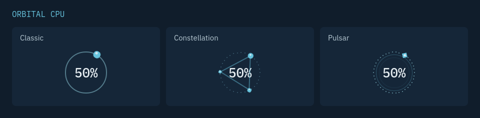
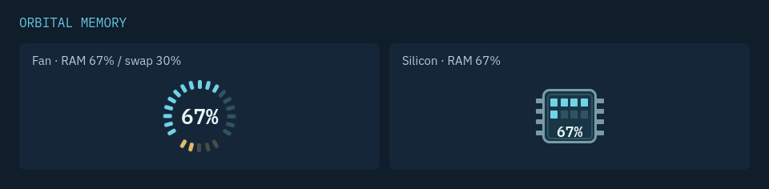
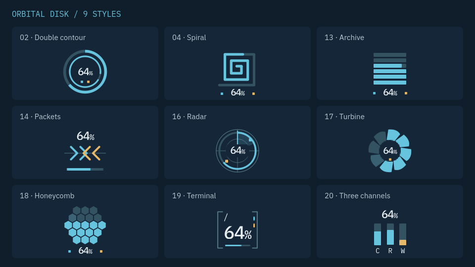
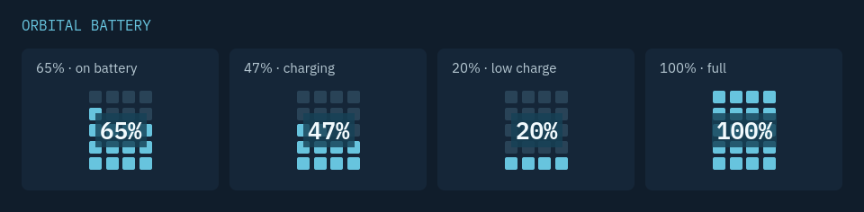
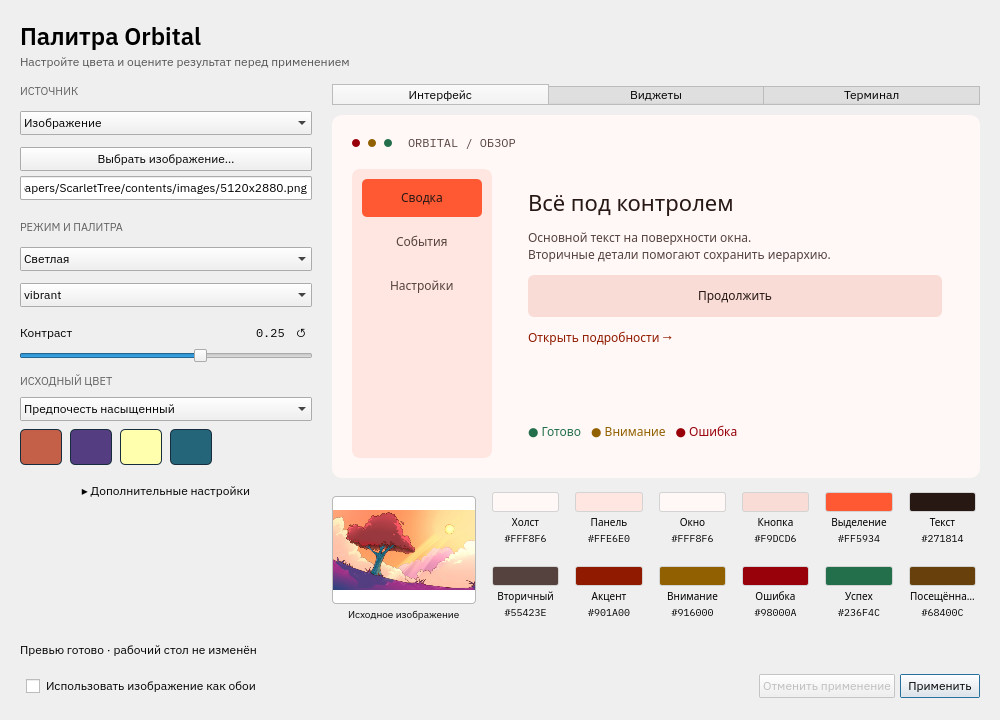

# Orbital KDE rice

A modular KDE Plasma 6 desktop with orbital system meters, a Moon-phase launcher,
and image-driven palettes. Dark navy, cyan and amber are the starting point;
light and generated color schemes work across the rice.

## Prerequisites

Tested on **Ubuntu 26.04.1 LTS, Plasma/PowerDevil 6.6.6, KDE Frameworks 6.24.0,
Qt 6.10.2, Wayland**. Other distributions, older Plasma releases and X11 have not
been validated. Battery uses private PowerDevil APIs matching Plasma 6.6.6.

All installation scripts require **Python 3.10+** and run as your desktop user
**without sudo**. Desktop, widget and Moon installation need an active Plasma
session managed by `plasma-plasmashell.service` and working user D-Bus/systemd.

| Component | Additional prerequisites |
| --- | --- |
| Desktop rice | `qdbus6`, `kpackagetool6`, `kwriteconfig6`, `kreadconfig6`, `plasma-apply-colorscheme`, `plasma-apply-desktoptheme`, `systemctl`, `fc-match`; IBM Plex Sans/Mono, Breeze/Breeze Dark GTK themes, and Oh My Zsh with `ZSH_THEME=` in `~/.zshrc`. One bottom panel with Kickoff, Pager and Icons-only Task Manager; no unmanaged top panel. Includes the CPU/Memory/Disk requirements below. |
| CPU, Memory, Disk | `qdbus6`, `kpackagetool6`, `systemctl`; Plasma, Kirigami and KDE settings QML modules, `org.kde.ksysguard.sensors` and Plasma5Support. Disk also uses `QtQuick.Shapes`. |
| Battery | The widget tools above, PowerDevil battery/brightness modules and `Qt5Compat.GraphicalEffects`. |
| Moon launcher | `qdbus6`, `systemctl`, an active graphical session and one Kickoff on the bottom panel. No PyQt, pip or network is needed. |
| Palette app | System PyQt6 with QtQml/QtQuick/QtWidgets, Qt Quick Controls/Layouts, Kirigami and the preview QML dependencies. Matugen **4.2.0** is reused or installed by the Palette target. |
| Downloads | Git for Tela Circle Blue; `curl`, `tar`, `sha256sum` and `install` for the pinned Matugen binary. Network is needed only when these assets are missing. The Matugen downloader supports Linux x86_64; other architectures must provide Matugen 4.2.0 first. |

On the checked Ubuntu system, relevant package names include `fonts-ibm-plex`,
`qml6-module-org-kde-ksysguard`, `qml6-module-qtquick-shapes`,
`qml6-module-qt5compat-graphicaleffects` and `python3-pyqt6`.
System packages are installed separately; the installer checks prerequisites.
See [compatibility and runtime details](docs/reference.md#requirements-and-compatibility).

## Installation

Run commands from this checkout in your normal user session.

### Install the complete rice

```bash
./scripts/install.sh all
```

Installs **Tela Circle Blue + desktop + CPU/Memory/Disk + Moon + Palette/Matugen**.
Battery and SDDM are separate. For a light first installation:

```bash
./scripts/install.sh all --theme orbital-light
```

The desktop step applies colors, fonts, icons, Konsole, the Oh My Zsh prompt,
wallpapers and the bottom panel. It preserves Kickoff, its icon, Pager, pinned
applications and supported Orbital settings; other bottom-panel widgets are
replaced. It creates a snapshot and restarts Plasma Shell. Repeating the command
updates the components and keeps the active palette and wallpapers unless
`--theme` is supplied.

### Install individual components

| Command | Result |
| --- | --- |
| `./scripts/install.sh desktop` | Desktop rice with icons and CPU/Memory/Disk. Accepts `--theme THEME_ID`. |
| `./scripts/install.sh widgets` | Install/upgrade CPU/Memory/Disk; also upgrade Battery if already installed. |
| `./scripts/install.sh cpu` | Install/upgrade only CPU. |
| `./scripts/install.sh memory` | Install/upgrade only Memory. |
| `./scripts/install.sh disk` | Install/upgrade only Disk. |
| `./scripts/install.sh battery` | Install/upgrade the optional Battery widget. |
| `./scripts/install.sh moon` | Install and activate the lunar icon on the existing Kickoff. |
| `./scripts/install.sh palette` | Install/update the Palette app and provide Matugen 4.2.0. Does not apply a theme. |
| `./scripts/install.sh icons` | Install Tela Circle Blue. |
| `./scripts/install.sh matugen` | Provide the pinned palette generator. |

Add newly installed standalone widgets through Plasma’s **Add Widgets** menu.
Widget installation preserves the panel layout and settings, takes a snapshot,
and restarts Plasma Shell once. Run the same command again to update.
The original component scripts remain available.

SDDM is an optional system change for an **already selected Kubuntu SDDM theme**:

```bash
sudo ./scripts/apply-sddm.sh
```

Each component keeps its own rollback. If `all` fails, it stops and reports
completed steps and recovery commands; completed components remain installed.
See [installation details](docs/reference.md#installation-details),
[restore](docs/reference.md#restore) and the
[`qdbus6` setuid fix](docs/reference.md#qdbus6-setuid-error).

## Overview & features

<a href="docs/images/desktop.png"></a>

The full-width bottom panel combines your existing launcher and task manager with
compact system meters. IBM Plex typography, Tela Circle Blue icons, original
orbital wallpapers, Konsole colors and the Zsh prompt complete the desktop.
Each widget also works independently and follows live KDE palette changes, or
keeps a custom palette. Previews below use native QML with fixed sample readings.

### CPU

<a href="docs/images/cpu-overview.png"></a>

Three animated orbit styles with usage-driven speed, configurable sizing and
padding. Hover for load, hottest-core temperature and average frequency;
click to open System Monitor.
[Settings and full gallery →](docs/reference.md#cpu)

### Memory

<a href="docs/images/memory-overview.png"></a>

Fan and Silicon RAM meters with a persistent percentage. Fan adds an optional
swap gauge; the tooltip shows RAM/swap usage and totals.
[Settings and full gallery →](docs/reference.md#memory)

### Disk

<a href="docs/images/disk-overview.png"></a>

Nine styles with partition selection, capacity and separate read/write activity.
Terminal is the default. Hover for space and transfer rates; low space is marked
at 90% used. Collection uses KDE sensors without shell polling or root access.
[Settings and full gallery →](docs/reference.md#disk)

### Battery · optional

<a href="docs/images/battery-overview.png"></a>

A 20-cell charge grid with a percentage badge and charging indicator. Click for
battery details, brightness, power profiles and sleep inhibition; scroll to
adjust brightness.
[Settings and full gallery →](docs/reference.md#battery)

### Moon launcher

Kickoff’s icon follows the real Moon using bundled offline calculations. It
adapts to the KDE palette, updates every 15 minutes and preserves your launcher
menu, favorites and shortcut. A manually selected icon pauses replacement.

```bash
~/.local/bin/orbital-moon status
~/.local/bin/orbital-moon uninstall
```

[How updates, storage and removal work →](docs/reference.md#lunar-application-launcher)

### Colors & Palette

<a href="docs/images/theme-editor.png"></a>

Switch Orbital Dark/Light or generate a palette from an image or HEX color.
Palette offers ten Matugen scheme types, contrast/lightness controls, source-color
selection, native widget previews and all 16 terminal colors. Apply with a
snapshot, optionally set the source as wallpaper, and undo the last apply.

```bash
~/.local/bin/orbital-theme edit
# The checkout CLI also works without installing the app:
./scripts/orbital-theme apply orbital-light
./scripts/orbital-theme from-wallpaper "/path/to/picture.jpg" --mode dark
```

Screenshot source: **Scarlet Tree** by axo1otl, from KDE;
[image attribution and license](THIRD_PARTY.md#palette-screenshot--scarlet-tree).
[Palette, CLI and recovery reference →](docs/reference.md#color-schemes)

## Reference & development

The [reference](docs/reference.md) covers detailed settings, storage, logs,
updates, removal, recovery and compatibility. See
[asset and screenshot generation](docs/reference.md#regenerate-assets)
for development commands and validation.

## Licensing & credits

Original code, documentation and orbital wallpapers: [MIT](LICENSE).
Battery: [LGPL-2.0-or-later](widgets/org.orbital.battery/LICENSE).
Breeze-derived color schemes: [GPL-2.0-or-later](LICENSES/GPL-2.0-or-later.txt).
The Palette screenshot is CC-BY-SA-4.0; see
[third-party credits and license coverage](THIRD_PARTY.md).
