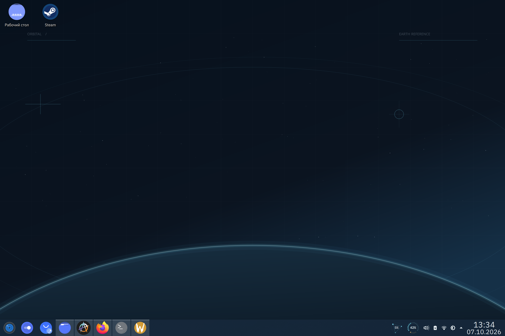
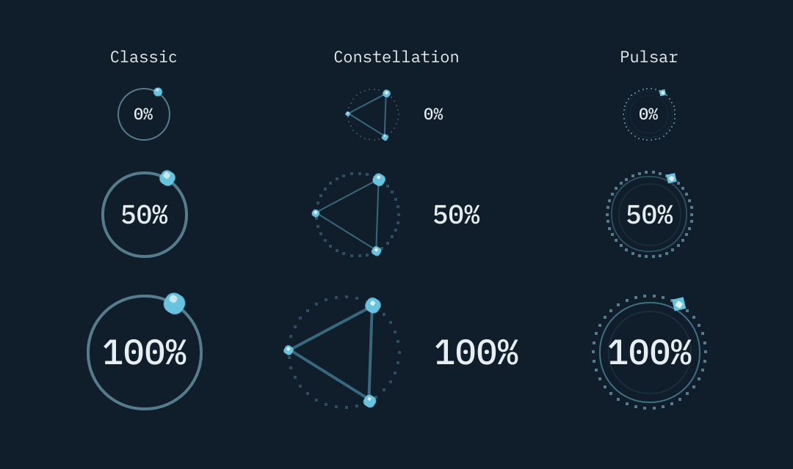
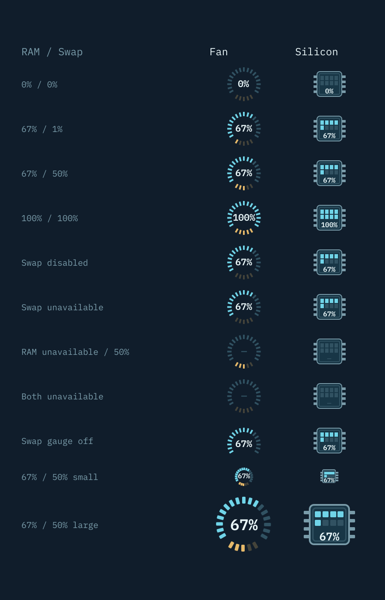

# Orbital KDE rice

A restrained mission-control look for KDE Plasma 6: dark navy surfaces, muted cyan and amber accents, original orbital wallpaper, a full-width bottom panel, IBM Plex typography, and Tela Circle Blue icons.



## Components

| Component | What it provides |
| --- | --- |
| [Orbital CPU](widgets/org.orbital.cpu/) | Animated Classic, Constellation and Pulsar orbits, CPU usage, and temperature/frequency tooltips. |
| [Orbital Memory](widgets/org.orbital.memory/) | Fan and Silicon RAM indicators with an optional Fan swap gauge. |
| [Orbital Battery](widgets/org.orbital.battery/) | A 20-cell charge grid with brightness, power profiles, and sleep inhibition controls. |
| [Appearance assets](assets/) | KDE colors, two SVG/PNG wallpapers, Konsole colors/profile, and an Oh My Zsh prompt. |
| [Installation scripts](scripts/) | Desktop setup, separate widget upgrades, snapshots, restore, and an optional SDDM override. |

The widgets are independent Plasma applet packages. They can be installed without applying the desktop theme.

## Requirements and compatibility

The preparation checks run on Ubuntu 26.04.1 LTS with Plasma and PowerDevil 6.6.6 on Wayland. Other distributions, older Plasma versions, and X11 have not been validated. In particular, the Battery popup uses private PowerDevil QML APIs matching Plasma 6.6.6; its metadata's minimum Plasma API version is not a compatibility guarantee.

For the full user theme, provide:

- An active Plasma session managed by `plasma-plasmashell.service`, with `qdbus6`, `kpackagetool6`, `kwriteconfig6`, `kreadconfig6`, `plasma-apply-colorscheme`, and `systemctl` available.
- Python 3 and Git; network access is needed only to download Tela Circle Blue when it is not already installed.
- IBM Plex Sans and IBM Plex Mono fonts, and the Breeze Dark GTK theme. On the checked Ubuntu system, the fonts are supplied by `fonts-ibm-plex`.
- Oh My Zsh with an existing `~/.zshrc` containing a `ZSH_THEME=` assignment.
- An existing bottom panel containing Application Launcher (Kickoff), Pager, and Icons-only Task Manager. Their configuration and pinned applications are preserved. Other widgets on that panel are replaced by the Orbital layout; an unrelated top panel is refused.

CPU and Memory require KDE's `org.kde.ksysguard.sensors` QML module (`qml6-module-org-kde-ksysguard` on the checked system). Battery requires PowerDevil's battery/brightness modules and `Qt5Compat.GraphicalEffects` (`qml6-module-qt5compat-graphicaleffects`). Standard Plasma, Kirigami, and KDE settings QML modules must also be installed. PyQt6 is needed only to regenerate assets or render previews, not for installation.

## Apply the user theme

Use the committed assets; regeneration is optional. From this directory:

```bash
./scripts/install-icons.sh
./scripts/apply-user.sh
```

The icon installer downloads the official Tela Circle source at a pinned commit. The user installer takes a dated snapshot under `backups/`, prints the exact restore command, and attempts to restore that snapshot if applying fails. It updates KDE and GTK colors/fonts, Konsole, the Zsh prompt, desktop and lock-screen wallpaper, and the bottom panel, then restarts Plasma Shell.

Reapplying preserves the bottom panel's height, existing launcher and selected launcher icon, and the Orbital widget settings described below. Backups are local and excluded from Git.

### Optional Kubuntu SDDM login screen

```bash
sudo ./scripts/apply-sddm.sh
```

This step targets an existing `/usr/share/sddm/themes/kubuntu/` theme and `/etc/sddm.conf.d/` directory. It does not install a login theme, change the selected SDDM theme, or adapt other themes. Use it only where the Kubuntu theme is already selected. It copies a system-readable wallpaper and writes overrides, with a separate root backup under `/var/backups/orbital-sddm/`. The next login shows the result.

### Install widgets separately

For a new installation of just the applets:

```bash
kpackagetool6 --type Plasma/Applet --install ./widgets/org.orbital.cpu
kpackagetool6 --type Plasma/Applet --install ./widgets/org.orbital.memory
kpackagetool6 --type Plasma/Applet --install ./widgets/org.orbital.battery
```

Then add them through Plasma's **Add Widgets** menu. These commands leave the theme and panel layout to you and do not create an Orbital snapshot.

To upgrade the three applets without changing an existing panel layout:

```bash
./scripts/upgrade-widgets.sh
```

This script takes a snapshot, installs or upgrades each package, and restarts Plasma Shell once while preserving widget settings. For one applet, use `kpackagetool6 --type Plasma/Applet --upgrade` with that applet's directory.

## Widget settings

Right-click a widget and open its configuration. The galleries below render the actual QML visual components with fixed sample values; they are not live telemetry screenshots.

### CPU



Choose **Classic** (the default single satellite), **Constellation** (three linked satellites), or **Pulsar** (a dotted orbit with a beacon and pulsing inner rings). Constellation can place its percentage beside the orbit or inside, behind the geometry.

Set the indicator to 60–150% of its panel-relative baseline, horizontal padding to 0–32 px per side, and vertical padding to 0–24 px per side. Panel height limits the effective size and vertical padding. Settings include an animated preview at 50% CPU. Maximum speed at 100% CPU is 0–120 RPM, with 30 RPM as the default; speed follows CPU usage linearly and 0% stops all motion.

Hover anywhere over the meter, including padding and percentage, for usage, hottest-core temperature in °C, and average frequency in GHz (two decimal places). Usage reuses the existing once-per-second reading. Temperature and frequency subscribe only while hovering, with updates limited to once per second and no shell polling. Loading or unavailable readings show a dash, including an initial zero temperature. Click to open Plasma System Monitor.

### Memory



Choose **Fan** (the default, 17 radial ticks) or **Silicon** (eight chip banks). Both read physical RAM usage once per second and keep the percentage visible in the center. Set the size to 60–110% of its panel-relative fit and customize the active, inactive, text, chip body, and chip outline colors.

Fan shows used swap as five amber ticks in its lower arc by default; even a small nonzero amount lights one tick. Toggle **Show swap gauge** or adjust **Swap color**. Hiding the gauge retains swap in the tooltip. Hover over Fan for separate RAM/swap used/total GB (two decimal places) and percentages. No configured swap is labeled disabled; unavailable readings show a dash. Click either style to open Plasma System Monitor.

The theme button copies current KDE colors into editable settings, using the neutral color for swap. Reapplying preserves style, size, swap toggle, and colors.

### Battery


The cyan 4×5 grid fills from bottom to top. Each solid cell represents a completed 5% of charge; all 20 cells light at 99%. While charging below 99%, the next empty cell pulses. The pulse stops at 99% or above or when charging stops.

Hover for a frosted percentage badge; it also appears at 20% or below. Settings can show the percentage permanently, customize grid/badge colors, or copy current KDE colors into editable fields. The grid keeps a fixed panel width. Click for battery details, brightness, power profiles, and sleep inhibition controls, or scroll to adjust screen brightness. The stock battery icon remains available in tray overflow after the full theme is applied. Reapplying preserves the Orbital appearance settings.

## Restore

```bash
./scripts/restore-user.sh
```

This restores the latest user snapshot. To choose a particular snapshot, pass the backup directory printed by the installer as the first argument. Restore is a return to that snapshot, so subsequent edits to the saved settings are replaced. Sign out and back in to refresh all running applications.

If the optional SDDM override was applied:

```bash
sudo ./scripts/restore-sddm.sh
```

Pass a root backup directory as the first argument to select an older SDDM snapshot. Sign out or reboot to refresh the login screen.

## Regenerate assets

Development only: install PyQt6 (`python3-pyqt6` on the checked Ubuntu system), Qt's SVG image support, IBM Plex fonts, and the Breeze Dark color template at `/usr/share/color-schemes/BreezeDark.colors`, then run:

```bash
python3 scripts/build_assets.py
```

The generator defaults to Qt's offscreen platform. It overwrites the KDE color scheme and the 3000×2000 / 2560×1440 SVG/PNG wallpapers in the checkout. A different Breeze version or font renderer may produce different output. Each widget also includes a `preview.qml` for its fixed-value gallery.

## Licensing and credits

Author-created code, documentation, terminal settings, and original orbital wallpaper are distributed under [MIT](LICENSE). The Battery package is [LGPL-2.0-or-later](widgets/org.orbital.battery/LICENSE), and the color scheme derived from KDE Breeze Dark is [GPL-2.0-or-later](LICENSES/GPL-2.0-or-later.txt).

See [license coverage and third-party credits](THIRD_PARTY.md) for source attribution, upstream versions, and external icon/font dependencies. Upstream licenses continue to cover their own materials, including third-party elements visible in the desktop screenshot.
